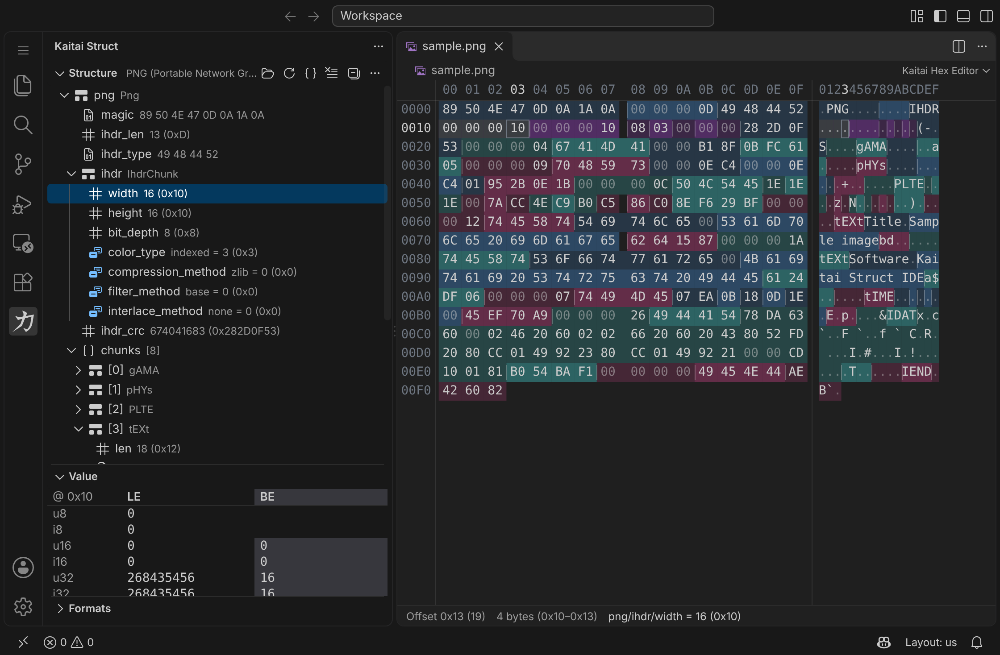
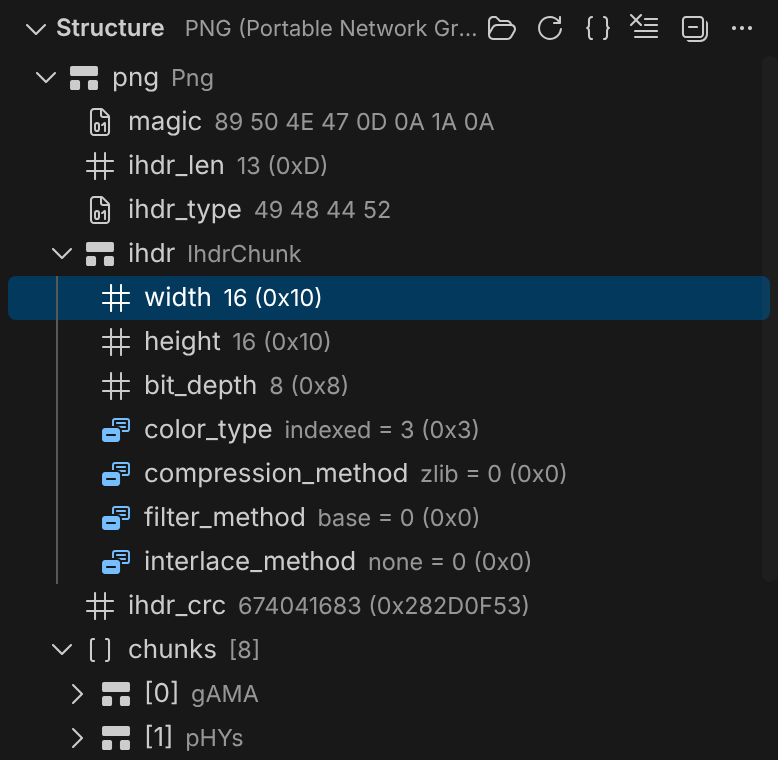
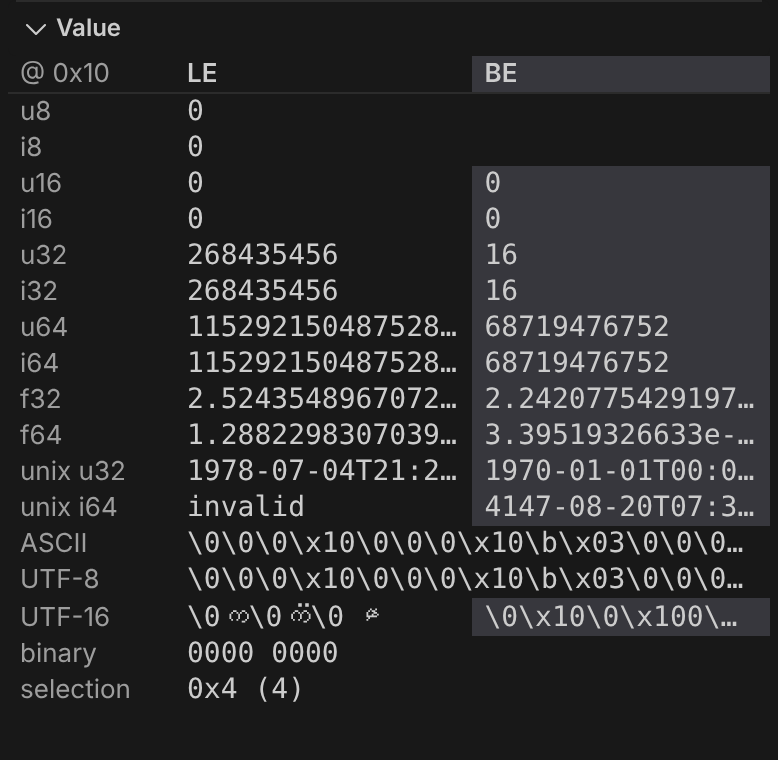
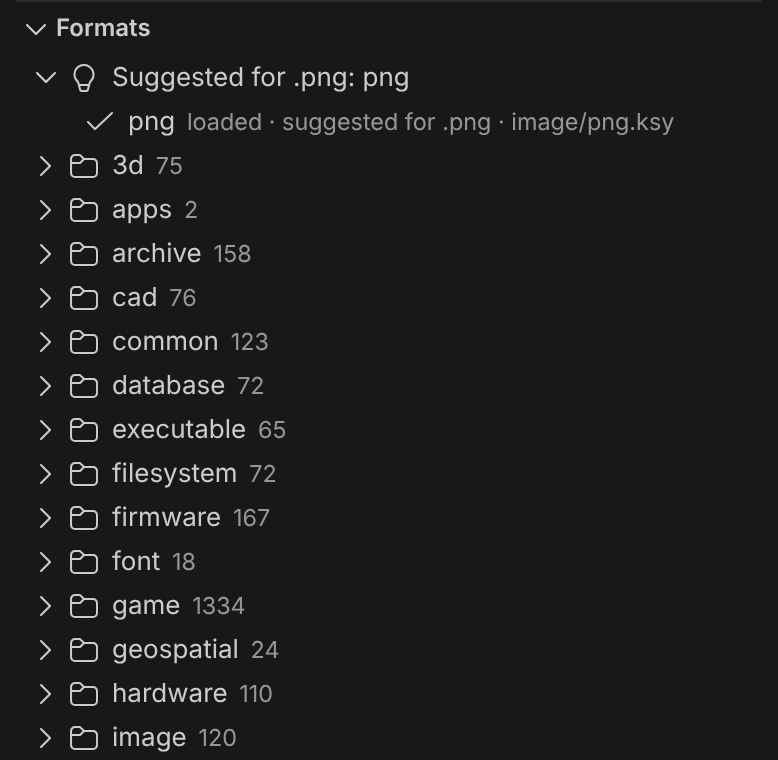

# Kaitai Struct IDE

Explore binary files with [Kaitai Struct](https://kaitai.io/) `.ksy` specs in VS Code: a field-coloured hex view, a structure tree, and live reparse while you edit the spec. It runs on desktop and in VS Code for the Web (vscode.dev, github.dev).

## Quick start

1. Right-click a binary file and select **Open in Kaitai Hex Editor**.
2. Open the **Kaitai Struct** view in the activity bar.
3. Select **Load Spec…**, or pick a spec from **Formats**. Specs that match the file extension are listed first.

| Structure | Value | Formats |
| --- | --- | --- |
|  |  |  |

## Features

**Explore**

- **Hex view** (read-only): coloured fields with nesting, error regions, and virtualised rows for large files. Press `]` and `[` to step through fields, and `N` to jump to the next unparsed gap.
- **Structure**: a lazy tree that stays in sync with the hex selection. It shows enum labels, parses instances on expand, and marks failed fields.
- **Value**: integers, floats, Unix times and strings at the caret, little-endian and big-endian side by side.
- **Formats**: a gallery of specs from `pl4nty/kaitai_struct_formats` (set `kaitai.formatsRepository` to change it). It also resolves absolute imports that are not in your workspace.
- **Find Value in File…** (Ctrl+F): `u4le 1234`, `f4 1.5`, `"text"`, `utf-16le "text"`, or hex with `??` wildcards.
- **Go to Offset…** (Ctrl+G): an offset or a range, such as `0x10-0x20` or `0x10+16`.
- **Copy As…**, **Export Parsed Tree as JSON** and **Save Bytes As…**.
- **Open Bytes in Hex Editor**: view the decoded bytes of a `process:` field (zlib, xor, rotate).

**Write specs**

- **Live reparse**: an edit to the `.ksy` or its imports, saved or not, reparses each open file that uses it.
- **Diagnostics** on the correct `.ksy` line, with quick fixes, completion, hover, go to definition and outline.
- **Add Field from Selection…**: select bytes, choose a type, and the `seq` entry is inserted into the spec.
- **Parse Selection as Type…**: try a type from the spec on the selected bytes.
- **Set Spec Params…** for specs with top-level `params`.
- **Show Generated Code…** for every compiler target.

## Limits

- The hex view is read-only, and the whole file is read into memory (`kaitai.maxFileSizeMB`, default 256).
- Compiled specs run as JavaScript in the extension host. Only load specs that you trust.
- Bit-sized fields highlight the bytes that they were read from.
- Fields inside a processed stream have no file position, so they have no colour. Open the stream to see them.
- **Formats** downloads its list from GitHub and keeps it for 24 hours.

## Licence

GPL-3.0-or-later, because it bundles the Kaitai Struct compiler. See [CONTRIBUTING.md](https://github.com/pl4nty/homelab/blob/main/apps/vscode-kaitai/CONTRIBUTING.md) to build it, and report problems in [GitHub issues](https://github.com/pl4nty/homelab/issues).
