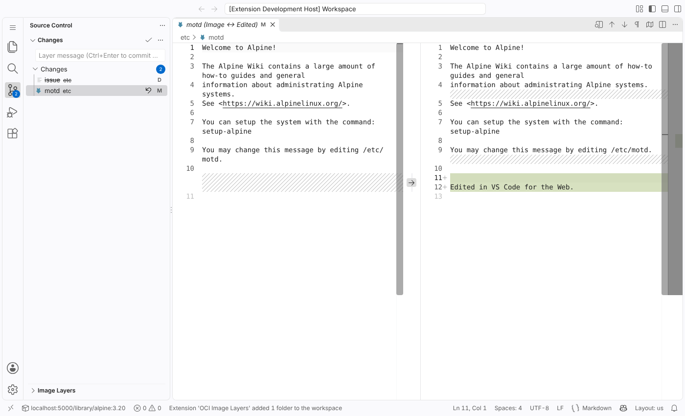
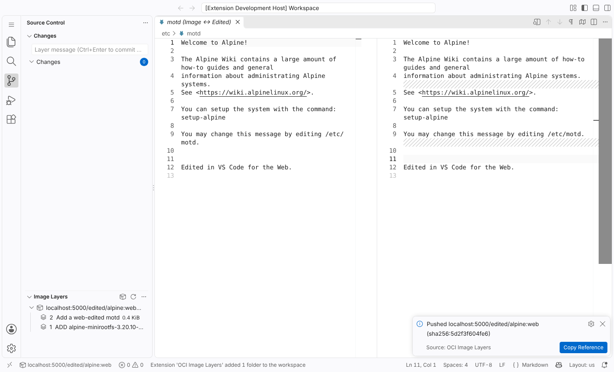

# OCI Image Layers for VS Code

Open a container image from a registry as a workspace folder, edit its files, and commit the edits as a new layer pushed to a registry. It runs in **VS Code for the Web** (web worker extension host), desktop VS Code, code-server and openvscode-server. It does not need a Docker daemon.




## Try it on vscode.dev

`https://vscode-oci-layers.${PUBLIC_DOMAIN}` serves the web extension and the CORS proxy ([`proxy/serve.mjs`](proxy/serve.mjs)).

1. Open https://vscode.dev and run **Developer: Install Extension from Location…** with that URL. "Install from VSIX" is not available in the web build.
2. Set **OCI Layers › Cors Proxy** (`ociLayers.corsProxy`) to the same URL with a trailing `/`.
3. Run **OCI Layers: Open Image…** with, for example, `ghcr.io/linuxcontainers/alpine:3.20`, then edit, commit and push. `ttl.sh/<anything>:1h` accepts anonymous pushes.

To run both locally instead:

```sh
npm install && npm run serve:web   # extension and proxy on http://127.0.0.1:8787
```

Chrome allows an `https://vscode.dev` page to call `http://localhost` and `http://127.0.0.1`, and may ask for local-network access. This flow was run headless against the real vscode.dev: install, ghcr.io pull, edit, push to ttl.sh, then `docker run`. Quick Open and Find in Files stay off because vscode.dev does not grant proposed APIs; use the **Find … in Image** commands.

## Usage

1. Run **OCI Layers: Open Image…** and enter a reference such as `alpine:3.20`, `ghcr.io/owner/app:tag` or `localhost:5000/app@sha256:…`.
2. The merged root filesystem appears as an `oci-layer://` workspace folder. Edit, create, rename and delete files normally.
3. The **Source Control** view lists the changes (A/M/D) and opens diffs against the image. Quick-diff gutters also work.
4. Type a message and press Ctrl+Enter (or click ✓). Choose the push target tag. The extension then:
   - builds a tar layer from the changes, using OCI whiteouts for deletions,
   - uploads the layer and a new config (`diff_ids` and `history` appended, runtime config unchanged),
   - pushes a new manifest.
5. The **Image Layers** view shows the image's layer history. Your commit's message is shown as the layer's label.

To push to a private registry, run **OCI Layers: Sign In to Registry…**. Credentials are stored in VS Code SecretStorage.

### Search

- **Quick Open (Ctrl+P) and the Search view (Ctrl+Shift+F)** work through the proposed [`fileSearchProvider2`](https://github.com/microsoft/vscode/blob/main/src/vscode-dts/vscode.proposed.fileSearchProvider2.d.ts) and [`textSearchProvider2`](https://github.com/microsoft/vscode/blob/main/src/vscode-dts/vscode.proposed.textSearchProvider2.d.ts) APIs. VS Code grants proposed APIs only in these cases:
  - **Extension development mode on Insiders.** Development mode on Stable is refused, including `vscode-test-web --quality stable`.
  - **`--enable-proposed-api pl4nty.oci-layers`** on desktop or code-server, or `"enable-proposed-api": ["pl4nty.oci-layers"]` in `argv.json`.
  - **A web workbench whose URL payload carries `enableProposedApi`.** The web workbench honours this; vscode.dev was not tested, and test-web ignores the payload.
- **Everywhere else**, registration fails quietly and the extension still activates. Use **OCI Layers: Find File in Image…** and **Find Text in Image…** instead (stable API, also in the Source Control "…" menu). Prefix text queries with `re:` for a regular expression.
- **Search behaviour:**
  - Searches the merged view, including uncommitted edits.
  - Honours include/exclude globs, case, whole-word, regex, multiline and the result limit.
  - Skips binary files (a NUL byte in the first 8 KiB) and does not follow symlinks.
  - Runs synchronously on the extension host. That is fine for typical images, but a search over hundreds of MB blocks the host while it runs.

| Setting | Default | Purpose |
|---|---|---|
| `ociLayers.platform` | `linux/amd64` | Platform to select from a multi-platform index |
| `ociLayers.corsProxy` | `""` | URL prefix for every request (browser only, see below) |
| `ociLayers.insecureRegistries` | `["localhost","127.0.0.1"]` | Hosts to reach over plain HTTP |
| `ociLayers.maxImageSizeMB` | `512` | Refuse larger images (everything is held in memory) |

### Browsers and CORS

In VS Code for the Web, the extension calls registries with `fetch()` from the extension host's origin. That origin is `https://v--<hash>.vscode-cdn.net` on vscode.dev. A browser only allows these calls if three different servers all send CORS headers:
- the registry API,
- its token realm,
- the blob CDN it redirects to.

On 2026-10-18 no major public registry did. Each `/v2/`, token, manifest and blob endpoint was probed with `Origin: https://vscode.dev`, a preflight and a GET:

| Option | Result |
|---|---|
| Docker Hub, ghcr.io, quay.io, public.ecr.aws, gcr.io / pkg.dev, registry.k8s.io, cgr.dev, GitLab, nvcr.io | No `Access-Control-Allow-Origin` on the API or token endpoints. Quay's CDN alone sends ACAO `*`. |
| mcr.microsoft.com | Exposes headers but sends ACAO only to allowlisted origins (e.g. portal.azure.com), not vscode.dev. |
| Mirrors: mirror.gcr.io, docker.m.daocloud.io, dockerproxy.com, and others | No CORS. docker.1ms.run allows CORS on the API and token endpoints, but its blob CDN does not, and it exposes no headers, so a pull still fails. |
| Public CORS proxies: corsproxy.io, corsfix, cors-anywhere, allorigins, codetabs, cors.lol | Need a paid key or a registered domain, require a manual opt-in, are rate-limited, or are down. Most are GET-only or strip `Authorization`. All of them would see your registry tokens. |

When a request is blocked, the extension reports `cannot reach <host> … set ociLayers.corsProxy` and offers a **Configure Proxy** button. Options, best first:

1. **Do not use the browser host.** Desktop VS Code, code-server and Codespaces run extensions in a Node extension host, which has no CORS. Nothing to configure.
2. **Deploy your own worker**, [`proxy/worker.js`](proxy/worker.js), with `npx wrangler deploy --config proxy/wrangler.toml`. Then set `"ociLayers.corsProxy": "https://<worker>/"`. It runs locally with `bun proxy/serve.mjs`. What it does:
   - Allows only vscode.dev, github.dev and `*.vscode-cdn.net` origins by default.
   - Forwards only to an allowlist of registry hosts. Both lists can be overridden with environment variables.
   - Answers preflights itself.
   - Follows blob CDN redirects on the server, dropping `Authorization` on cross-host hops.
   - Exposes `WWW-Authenticate`, `Location` and `Docker-Content-Digest`.

   Caveats, from Cloudflare's [published limits](https://developers.cloudflare.com/workers/platform/limits/) (not measured):
   - The free tier allows 100k requests/day, and request bodies are limited to 100 MB. A single layer larger than that cannot be pushed, because uploads are monolithic.
   - Docker Hub is reported to rate-limit Cloudflare IPs. Opening `mirror.gcr.io/library/<image>` works around that for pulls.
   - The worker sees your credentials, so only use one you deploy yourself.
3. **Configure CORS on a registry you control.**
   - `distribution/registry` `http.headers` adds headers but still returns 401/405 to `OPTIONS`, which fails the browser preflight. Put nginx in front to answer `OPTIONS` with 204, and use `add_header … always` so 401 responses carry the headers too. `Access-Control-Allow-Headers` must list `Authorization, Accept, Content-Type`, and `Access-Control-Expose-Headers` must list `WWW-Authenticate, Location, Docker-Content-Digest`.
   - Zot's `http.allowOrigin` covers pulls only: its fixed allowed-headers list omits `Accept`, and its preflight rejects pushes.

## Design

```
src/core/            no vscode / Node imports: runs in a web worker
  reference.ts       Docker reference normalisation (docker.io → registry-1.docker.io, library/)
  registry.ts        OCI distribution client: Bearer/Basic challenges, index → platform manifest,
                     digest-verified blobs, cross-repo mount, monolithic upload, manifest PUT
  tar.ts             ustar/PAX/GNU reader, ustar+PAX writer
  overlay.ts         Tree = merged lower layers (whiteouts, opaque dirs, hardlinks)
                     Overlay = Tree + in-memory upper layer; symlink resolution; changes(); toLayerEntries()
  session.ts         open (pull + merge) and commit (layer → config → manifest)
  search.ts          file walk, glob filters, fuzzy file match, text search with UTF-16 ranges
src/                 VS Code glue: FileSystemProvider (oci-layer:, read-only oci-layer-base:),
                     SourceControl + QuickDiff, file decorations, layers tree view
```

- **Upper-layer semantics** follow the [OCI layer spec](https://github.com/opencontainers/image-spec/blob/main/layer.md#whiteouts):
  - Deleting a path that exists in the base writes `.wh.<name>`.
  - Deleting and then recreating a directory writes `.wh..wh..opq`.
  - Edits keep the original mode, uid and gid.
  - Writes through a symlink go to the target. For example, `/bin/x` on merged-usr Debian lands in `/usr/bin/x`.
- **Persistence.** Adding the first workspace folder restarts the extension host, so the session reference and the pending edits are stored in `globalState` and reloaded on activation. If the host does not restore the workspace (for example, a reloaded browser tab with an untitled workspace), you get a prompt to reopen images that have uncommitted changes.
- **Push target.** Blobs are cross-repo mounted when the target is on the same registry. Otherwise they are copied. Docker v2 manifests stay Docker v2, and OCI manifests stay OCI.

## Verification

- `npm test`: 15 unit and integration tests (Node 22, `--experimental-strip-types`):
  - tar round-trips, and interoperability with GNU tar in gnu, pax and ustar formats.
  - Whiteout, opaque-dir and hardlink merge. The key invariant: applying `toLayerEntries()` onto the base gives exactly the overlay's view.
  - Pull → edit → commit → push → re-pull against an in-process registry with token auth and cross-repo mounts.
  - zstd and zstd:chunked layers (multiple frames and skippable frames).
  - Glob semantics, fuzzy file search, and text search (UTF-16 ranges, regex, multiline, word match, binary skip, limits) over the merged view.
- `scripts/smoke.ts`: pulls a real image from Docker Hub, edits it, pushes it and re-pulls it. Checked with `alpine:3.20`, `nginx:alpine` and `debian:bookworm-slim`. The Debian result, pushed to `registry:2`, was then **run with `docker run`**. The edit was present, the deleted file was gone, `/bin -> usr/bin` was intact, and `Cmd` was preserved.
- `test/e2e/web.mjs`: Playwright drives VS Code for the Web (`@vscode/test-web`, headless Chromium) through these steps:
  1. Open the image.
  2. Edit in the explorer and delete a file.
  3. Reload the page and click Reopen.
  4. Open the diff.
  5. Commit with Ctrl+Enter and push.
  6. Check the layers view.

  The pushed image was then pulled and run with Docker.
- `test/e2e/search.mjs`: two runs against an image built by BuildKit with `compression=zstd`:
  - **Insiders, development mode:** Quick Open finds `etc/zstd-marker`, and the Search view finds `ttyS0` (3 results in 2 files) and opens the match.
  - **Stable with `FALLBACK=1`:** the proposals are refused and logged, and both Find … in Image commands work.
- `test/e2e/proxy.mjs`: a real public-registry round trip in VS Code for the Web, through `proxy/worker.js` running under Bun. With no proxy set, opening `ghcr.io/linuxcontainers/alpine:3.20` fails with the CORS hint. **Configure Proxy** opens the setting. The test then pulls from ghcr.io (token, manifest and blobs, with the CDN redirect followed on the server), edits `/etc/motd`, and pushes anonymously to `ttl.sh`. The pushed image was run with `docker run`. The worker has not been deployed to Cloudflare itself.
- A zstd image (BuildKit `compression=zstd`) was opened, edited, committed with a gzip layer and run with `docker run`.

```sh
npm install && npm run build && npm test
npx vscode-test-web --browserType=none --extensionDevelopmentPath=. --port 3000 --quality insiders &
node test/e2e/web.mjs      # needs a CORS-enabled registry at localhost:5000 holding library/alpine:3.20
node test/e2e/search.mjs   # needs localhost:5000/zstd/alpine:latest (see the script header)
node test/e2e/proxy.mjs    # needs proxy/serve.mjs on :8787; pulls ghcr.io, pushes ttl.sh
```

Running two `vscode-test-web` servers with different `--quality` values from one folder makes the second delete the first one's download.

**Not tested:** vscode.dev or github.dev with a hosted build, the worker on Cloudflare itself, code-server, authenticated pulls or pushes (only anonymous ones were tested: ghcr.io pulls and ttl.sh pushes through the proxy), Windows images, and very large images.

## Limitations

- **Memory.** Every layer is downloaded, decompressed and held in memory.
- **Compression.** Layers can be gzip, zstd (including `zstd:chunked`, which adds skippable frames) or uncompressed, detected by magic bytes. zstd uses the native `DecompressionStream('zstd')` when the runtime has it (Node 22.22 and Chromium 141 do not, as tested), and otherwise falls back to [fzstd](https://github.com/101arrowz/fzstd), a pure-JS decoder that adds about 8 KB. New layers are always written as gzip, which is valid on top of zstd layers.
- **Single platform.** Pushing to a tag that pointed at a multi-platform index replaces it with a single-platform manifest. The commit prompt warns you about this.
- **Metadata.** There is no UI for chmod or chown. New files get `0644 root:root`. Extended attributes (for example `security.capability`) are not read or written, so editing a file that has them drops them. A hardlinked file becomes a standalone copy when you edit it.
- **Search.** Quick Open and Find in Files need proposed APIs; see [Search](#search) above. The fallback commands cover the rest.
- **Commit pushes immediately.** There is no local commit and no export to an OCI layout or `docker load` tarball.
- **New digest.** Any commit changes the manifest digest, so existing signatures and attestations no longer apply to the result.
- **Sessions.** globalState is shared across windows, and clean sessions are never garbage-collected automatically. The cost is a few bytes per opened image.

## Prior art

As of 2026-10-18, I found nothing that does the whole flow of editing image files in an editor and committing them as a layer. Searches covered the VS Code Marketplace, Open VSX, GitHub and the web.

| Project | What it does | Gap |
|---|---|---|
| [`crane edit fs`](https://github.com/google/go-containerregistry/blob/main/internal/cmd/edit.go) (go-containerregistry, hidden subcommand) | Edits **one file** in `$EDITOR` and pushes it as a new layer | Closest in behaviour: single file per run, CLI only |
| [`crane append` / `mutate`](https://github.com/google/go-containerregistry/blob/main/cmd/crane/doc/crane_append.md), [`regctl image mod`](https://regclient.org/cli/regctl/image/mod/) | Append tarball layers, change config | You build the tar yourself |
| [`buildah commit`](https://github.com/containers/buildah/blob/main/docs/buildah-commit.1.md), `docker commit` | Commit a container's read-write layer | Needs a runtime and local storage |
| [Container Tools](https://github.com/microsoft/vscode-containers) (ex-Docker extension) | Read/write FileSystemProvider for **running containers** | Not images; needs a daemon; no layers or commit; Node-only |
| [OCI Layout Explorer](https://marketplace.visualstudio.com/items?itemName=jpinz.oci-layout-explorer) | Read-only tree of an OCI layout's manifests, configs and layers | Read-only; needs `oras` or `docker` |
| [dive](https://github.com/wagoodman/dive), [explore.ggcr.dev](https://explore.ggcr.dev/), [dagdotdev](https://github.com/jonjohnsonjr/dagdotdev) | Browse layers and filesystems | Read-only; the web ones run server-side |
| [container-wasm](https://github.com/ktock/vscode-container-wasm) | Runs containers inside VS Code for the Web | No editing. Its README also hits the registry CORS problem |
